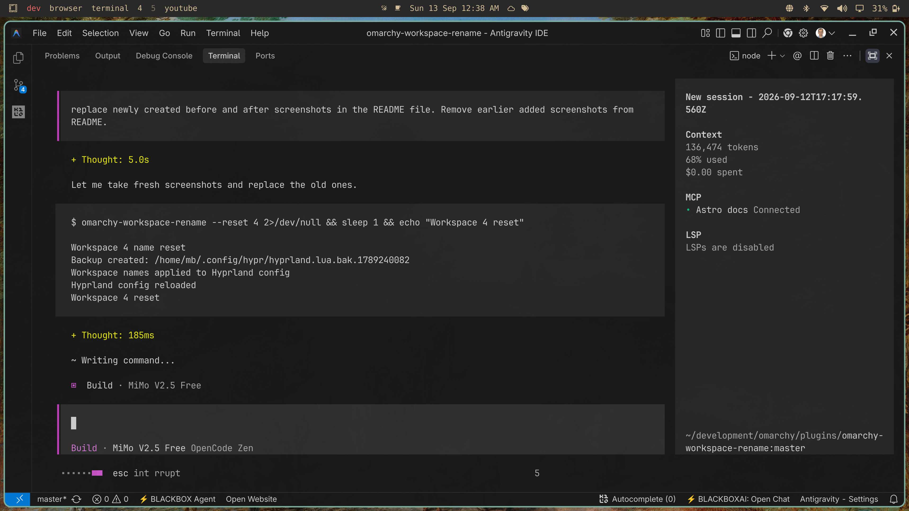
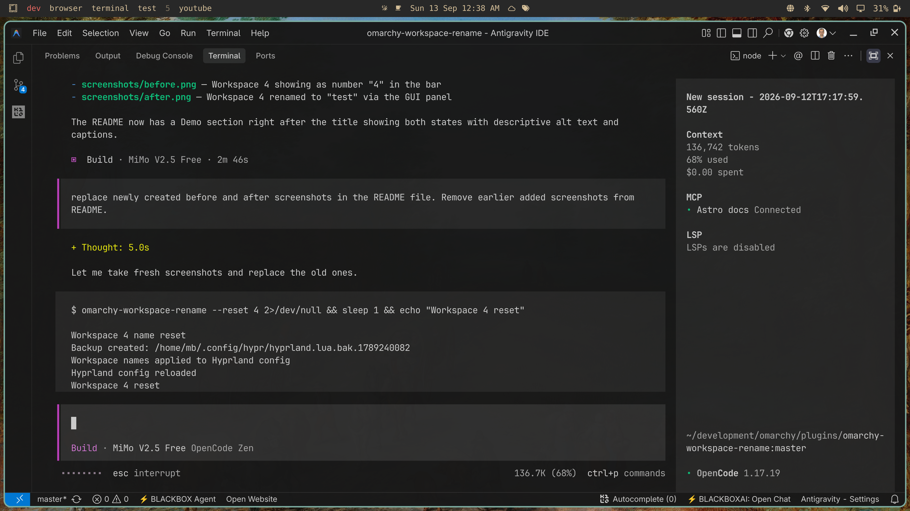

# Workspace Rename

Rename Hyprland workspaces with custom short names via an interactive GUI panel. Names persist across system restarts and Omarchy updates.

> **Note:** See [CHANGELOG.md](CHANGELOG.md) for the latest updates and migration instructions.

## Demo

**Before** — Workspace 4 displays as its default number "4" in the bar:



**After** — Workspace 4 renamed to "test" via the GUI panel:



## Features

- Click-to-rename: Click the active workspace on any monitor to open the rename panel
- Multiple monitors: Each bar follows its own monitor, with independent workspace names
- Interactive GUI: Type your custom name in a text field
- Persistent: Names survive restarts and Omarchy updates
- Theme-aware: Panel follows your Omarchy theme
- No dependencies: Uses only Omarchy-included tools

## Install

```bash
omarchy plugin add https://github.com/MBhalkar/omarchy-workspace-rename.git --enable
```

After installation, the workspace numbers in your bar will be clickable.

### Dependencies

The plugin uses standard tools included with Omarchy:
- `bash`
- `jq` (for JSON state management)
- `hyprctl` (for switching workspaces)
- Quickshell (Omarchy's shell framework)

## Usage

### GUI Method

1. **Left-click** any workspace number to switch to that workspace (standard behavior)
2. **Left-click** the **currently active** workspace on that monitor to open the rename panel
3. A rename panel appears below with a text field
4. **Type** your custom name
5. **Press Enter** to save, or **Escape** to cancel
6. Clear the field and press Enter to reset the label

Invalid names and save errors remain visible in the panel.

### CLI Method

The plugin also provides a command-line tool. Run it from its install directory
(`~/.config/omarchy/plugins/io.github.mbhalkar.workspace-rename/`), or add that
directory to your PATH. Prefix the commands below with `./` when running there.

CLI commands take global workspace IDs. Omarchy assigns each monitor a persistent
block of ten IDs: 1–10, 11–20, and so on. The bar displays local slots 1–10
(with slot 10 shown as 0), and the rename panel selects the global ID automatically.
For example, workspace 1 and workspace 11 can have independent names. Blocks can
have gaps after monitors have been disconnected.

```bash
# Rename a workspace
omarchy-workspace-rename <workspace_id> <new_name>

# Reset a workspace to original number (just provide the ID)
omarchy-workspace-rename <workspace_id>

# List all workspace names
omarchy-workspace-rename --list

# Reset a workspace to default
omarchy-workspace-rename --reset <workspace_id>
```

Examples:
```bash
omarchy-workspace-rename 1 dev
omarchy-workspace-rename 2 web
omarchy-workspace-rename 3 terminal
omarchy-workspace-rename 1          # Resets workspace 1 to just "1"
omarchy-workspace-rename --list
omarchy-workspace-rename --reset 1
```

### Naming Rules

- CLI workspace IDs must be positive integers, up to 2147483647
- Names are limited to 30 characters
- Names cannot contain spaces (use underscores instead)
- Names use letters, numbers, underscores and hyphens
- An empty GUI field resets the label; use `--reset` in the CLI

## How it works

1. Displays workspace numbers as clickable buttons in your bar
2. When the focused workspace is clicked, shows a popup panel with a text field
3. Stores your custom names in `~/.local/share/omarchy-workspace-rename/workspace-names.json`
4. Each bar watches that file and updates labels automatically

Names are bar labels; numeric workspace IDs and keyboard navigation stay intact.
Saving does not edit `hyprland.lua`, create configuration backups, or reload Hyprland.

## Data Storage

- **Workspace names**: `~/.local/share/omarchy-workspace-rename/workspace-names.json`
- **Monitor blocks**: Read from Omarchy's `$XDG_STATE_HOME/omarchy/monitors/workspaces`
  (default `~/.local/state/omarchy/monitors/workspaces`)

## Tests

```bash
bash tests/run
node tests/multi-monitor.cjs
```

The regression suite requires Node.js for testing only. It exercises monitor
selection, workspace labels and dispatch, rename submission, independent names
across monitor blocks, and saves without config changes or compositor reloads.
All CLI test state is isolated in temporary directories.

## Remove

```bash
omarchy plugin remove io.github.mbhalkar.workspace-rename
```

Your workspace names will remain in `~/.local/share/omarchy-workspace-rename/` so reinstalling restores them. To completely remove all data:

```bash
rm -rf ~/.local/share/omarchy-workspace-rename/
```

## License

MIT License - see [LICENSE](LICENSE) for details.
